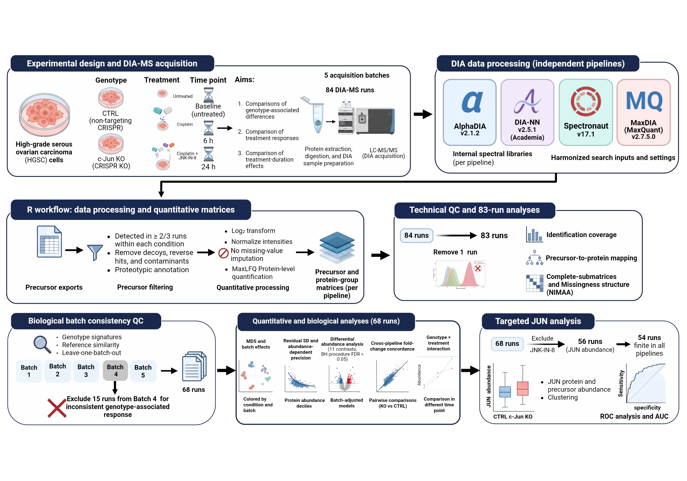

# Beyond Identification Counts In DIA Proteomics Pipelines

A comparative benchmark of **AlphaDIA, DIA-NN, Spectronaut and MaxDIA** using a common data-independent acquisition (DIA) proteomics dataset. This repository accompanies the MSProt 2026 capstone research project and provides the downstream statistical analysis, harmonized analysis guidelines, quality-control results and publication-ready figures.

The central objective is to evaluate DIA pipelines not only by the number of identified precursors and proteins, but also by the completeness, reproducibility, precision and biological interpretability of their quantitative measurements.

**Start here:** [Full analysis report (PDF)](DIA_CapstoneProject2026.pdf) · [Analysis source (R Markdown)](DIA_CapstoneProject2026.Rmd) · [Publication figures](Manuscript/) · [R session information](R_session_info.txt)

## Contents

- [Experimental and computational workflow](#experimental-and-computational-workflow)
- [Experimental design](#experimental-design)
- [Benchmarking methodology](#benchmarking-methodology)
- [Results and figures](#results-and-figures)
- [Repository structure](#repository-structure)
- [Reproducing the analysis](#reproducing-the-analysis)
- [Data availability](#data-availability)
- [Citation and license](#citation-and-license)

## Experimental and computational workflow



**Figure 1.** Overview of the experimental and computational workflow for DIA proteomics benchmarking.

The four pipelines process a common dataset, followed by harmonization of software-specific precursor outputs and a shared downstream analysis in R. The [harmonized proteomics protocol](Guideline/Harmonized_Proteomics_Protocol.Rmd) describes the intended common search settings, including an Orbitrap Astral acquisition context, shared sequence database and contaminant set, tryptic digestion, modifications and false discovery rate control. Exact equivalence of search algorithms and scoring strategies is not assumed. The protocol names OpenMS among the planned tools; the downstream benchmark itself uses AlphaDIA, DIA-NN, Spectronaut and MaxDIA.

## Experimental design

The analysis investigates c-Jun-dependent proteomic responses to cisplatin (cDDP), including control (CTRL) and c-Jun knockout (KO) samples, baseline and 6-hour/24-hour conditions, and JNK-IN-8 inhibitor conditions. Sample metadata encode genotype, treatment, time, replicate and acquisition batch (Groups 1–4).

| Analysis stage | LC-MS runs | Description |
| --- | ---: | --- |
| Initial dataset | 84 | Software-specific precursor import and initial QC |
| QC-filtered dataset | 83 | Exclusion of shared outlier `Group1_c-jun_KO_1` |
| Primary dataset | 68 | Additional exclusion of the 15 Group 4 runs; eight experimental conditions |

Group 4 was excluded after biological QC revealed absent or reversed expected JUN depletion in KO samples across the four pipelines. Precursor-level inspection and leave-one-batch-out validation supported concerns about this batch. These observations do **not** establish the cause or confirm sample mislabeling. The 83-run analysis is retained for sensitivity comparisons in the analysis workflow.

## Benchmarking methodology

| Stage | Approach |
| --- | --- |
| Harmonization | Standardize precursor identifiers, run names, intensities and annotations; resolve duplicates and represent zero intensities as missing values |
| Data representation | Construct linked precursor and protein assays using `QFeatures` and `SummarizedExperiment` |
| Preprocessing | Log2 transformation, inspection of intensity distributions, treatment of suspected Spectronaut floor values, shared outlier removal |
| Filtering | Detection in at least two-thirds of samples in any condition; remove decoys and contaminants and retain proteotypic peptides where annotations permit |
| Normalization | Pipeline-specific median-of-ratios normalization of log2 precursor intensities |
| Protein quantification | Aggregate normalized precursor measurements to protein level |
| Missingness | Evaluate incidence matrices, maximal rectangles, lollipop summaries and nestedness at precursor and protein levels |
| Quality control | Charge states, identification overlap, completeness, detection frequency, MDS, correlations and condition–batch balance |
| Statistical inference | Robust batch-adjusted protein-level modeling with `msqrob2`, contrast estimability checks and multiple-testing correction |
| Cross-pipeline agreement | Differential abundance overlap, log2 fold-change agreement, temporal genotype interactions, within-condition reproducibility and abundance-dependent precision |
| Biological validation | JUN abundance at precursor and protein levels and leave-one-batch-out genotype discrimination |

Proteotypic status could not be verified for AlphaDIA and Spectronaut using the available combined annotations. Proteins supported by a single peptide are not automatically excluded. Temporal contrasts without overlapping acquisition batches require cautious interpretation and should not be treated as longitudinal measurements.

## Results and figures

### Initial precursor coverage

The following values are from the initial 84-run [summary table](Outputs/combined_summary_84runs.csv), before downstream filtering and biological QC.

| Pipeline | Unique precursors | Median quantified per run | Missing values (%) |
| --- | ---: | ---: | ---: |
| AlphaDIA | 324,817 | 167,360.5 | 47.68 |
| DIA-NN | 305,009 | 183,826.5 | 40.97 |
| Spectronaut | 201,310 | 201,310 | 0.00029 |
| MaxDIA | 361,717 | 200,821.5 | 49.48 |

These are initial reported coverage statistics, not a ranking of analytical performance. In particular, the analysis investigates suspicious low-intensity values in Spectronaut before interpreting completeness.

### Publication figures

| Figure | Topic | File |
| --- | --- | --- |
| 1 | Experimental and computational workflow | [PNG](Fig1.png) |
| 2 | Identification and coverage | [PDF](Manuscript/Figure_2_Identification.pdf) |
| 3 | NIMAA completeness | [PDF](Manuscript/Figure_3_NIMAA_8Panels.pdf) |
| 4 | Missingness summaries and nestedness | [PDF](Manuscript/Figure_4_NIMAA_Lollipop_Nestedness.pdf) |
| 5 | Reproducibility and precision | [PDF](Manuscript/Figure_5_Reproducibility_Precision.pdf) |
| 6 | Differential abundance | [PDF](Manuscript/Figure_6_Differential_Abundance_68.pdf) |
| 7 | Fold-change agreement | [PDF](Manuscript/Figure_7_FoldChange_Agreement_68.pdf) |
| 8 | Temporal interactions | [PDF](Manuscript/Figure_8_Temporal_Interactions_68.pdf) |
| 9 | JUN abundance across pipelines | [PDF](Manuscript/Figure_9_JUN_Six_Panels_68.pdf) |
| Supplementary | Additional analyses | [Supplementary PDF](Manuscript/Supplemantary.pdf), [fold-change agreement](Manuscript/Figure_Sx_FoldChange_Agreement_68.pdf) |

Additional outputs include [identification-score QC](Outputs/Identification_Score_QC_All_Software.pdf), [precursor missingness](Outputs/NIMAA_precursor.pdf), [protein missingness](Outputs/NIMAA_protein.pdf), [abundance-dependent precision](Outputs/p_abundance_precision_68.pdf), [leave-one-batch-out AUC](Outputs/p_lobo_auc.pdf) and [volcano plots](Outputs/volcano_plots_68/). The [Outputs directory](Outputs/) contains additional PDF, CSV and serialized R objects.

## Repository structure

```text
MSProt2026Paper/
├── README.md
├── Fig1.png
├── DIA_CapstoneProject2026.Rmd       # Main analysis
├── DIA_CapstoneProject2026.pdf       # Rendered report
├── DIA_CapstoneProject2026.tex       # Generated LaTeX
├── DIA_CapstoneProject2026_files/    # Report figure assets
├── MSProt2026Paper.Rproj             # RStudio project
├── R_session_info.txt                # Recorded software environment
├── Archive.Rmd                      # Archived analysis
├── Guideline/                       # Protocols and FASTA resources
├── MSProt2026Paper_E/                # Separate NIMAA benchmark script
├── Manuscript/                      # Publication and supplementary figures
└── Outputs/                         # Intermediate and final outputs
```

The tree omits backup files and system metadata. See also the [general guideline](Guideline/generalGuideline.Rmd) and [standalone NIMAA script](MSProt2026Paper_E/nimaa_missingness_benchmark.R).

## Reproducing the analysis

### 1. Obtain the repository

```bash
git clone https://github.com/jafarilab/MSProt2026Paper.git
cd MSProt2026Paper
```

The existing PDF report and publication figures can be inspected without running R.

### 2. Configure the R environment

The recorded environment uses R 4.6.2 on Ubuntu 22.04.5 LTS. Exact package versions are listed in [R_session_info.txt](R_session_info.txt). The following is a starting point for installing the packages declared in the main analysis, not a version-locked environment:

```r
install.packages(c(
  "BiocManager", "data.table", "scales", "tidyverse", "ggh4x",
  "matrixStats", "patchwork", "kableExtra", "arrow", "ggcorrplot",
  "knitr", "rmarkdown", "bipartite", "ggalluvial"
))
BiocManager::install(c(
  "SummarizedExperiment", "QFeatures", "msqrob2", "ExploreModelMatrix",
  "MsCoreUtils", "ComplexHeatmap", "scater"
))
```

PDF rendering additionally requires Pandoc and a LaTeX installation with XeLaTeX. Package versions and system dependencies may need adjustment to match the recorded environment.

### 3. Obtain the input files

The main R Markdown expects the following software-specific search outputs:

| Pipeline | Required input |
| --- | --- |
| AlphaDIA | `precursor.matrix.tsv` |
| DIA-NN | `Team2_DIA-NN_report.pr_matrix.tsv` |
| Spectronaut | `FilteredCleaned_Spectronaut_Report.RDS` |
| MaxDIA | `Team4_MaxDIA_evidence.txt` |

These four inputs are not included in the repository snapshot. Obtain them separately before attempting execution.

### 4. Configure paths and execution mode

Open `DIA_CapstoneProject2026.Rmd` and edit the `setup paths` chunk to point `base_dir`, the four input file variables and `cache_dir` to your local files. The existing `localRepo` switch uses machine-specific paths.

The setup chunk defines `run_analysis <- FALSE` by default. Set it to `TRUE` to enable computationally expensive analysis chunks. Cached mode still requires the input files and relevant cached objects; the `Outputs/` directory is not a complete substitute for `R_cache`. Use a fresh cache for a full rerun, since some chunks modify saved objects in place.

Once inputs, paths, dependencies and required caches are configured, the intended rendering command is:

```r
rmarkdown::render("DIA_CapstoneProject2026.Rmd")
```

**Reproducibility status:** the repository supports inspection of the recorded analysis and results, but a fresh clone is not currently sufficient for a verified end-to-end rerun. The command above is not a guarantee of successful execution.

### 5. Standalone NIMAA benchmark

The [NIMAA missingness benchmark](MSProt2026Paper_E/nimaa_missingness_benchmark.R) records NIMAA version 0.2.2 and expects a separate input directory containing:

- `NIMAA_benchmark/matrices/primary_matrices.rds`
- `NIMAA_benchmark/results/harmonized_samples.csv`
- `NIMAA_peptide_benchmark/matrices/*_primary.rds`

These inputs are not present in the repository snapshot. Once they are available, the script accepts the input root and an optional output directory:

```bash
Rscript MSProt2026Paper_E/nimaa_missingness_benchmark.R /path/to/input-root /path/to/results
```

## Data availability

The repository includes search guidelines, FASTA resources, selected analysis outputs, publication figures and the recorded R environment. Raw mass spectrometry files, the four primary software exports and the complete computational cache are not included in the inspected snapshot. A public data accession or download location has not been specified in the available repository documentation.

## Citation and license

The main analysis report is titled *Comparative Evaluation of Four DIA Proteomics Pipelines — Capstone Project 2026* and identifies Mohieddin Jafari as its author. The complete manuscript author list, publication status and DOI are not specified here. Until a formal manuscript citation is available, refer to the [project repository](https://github.com/jafarilab/MSProt2026Paper) and the relevant revision when referencing these materials.

No root-level license is currently provided. Consult the repository maintainers regarding reuse and redistribution. Questions about the analysis can be directed to the maintainers through the repository's available contact channels.
